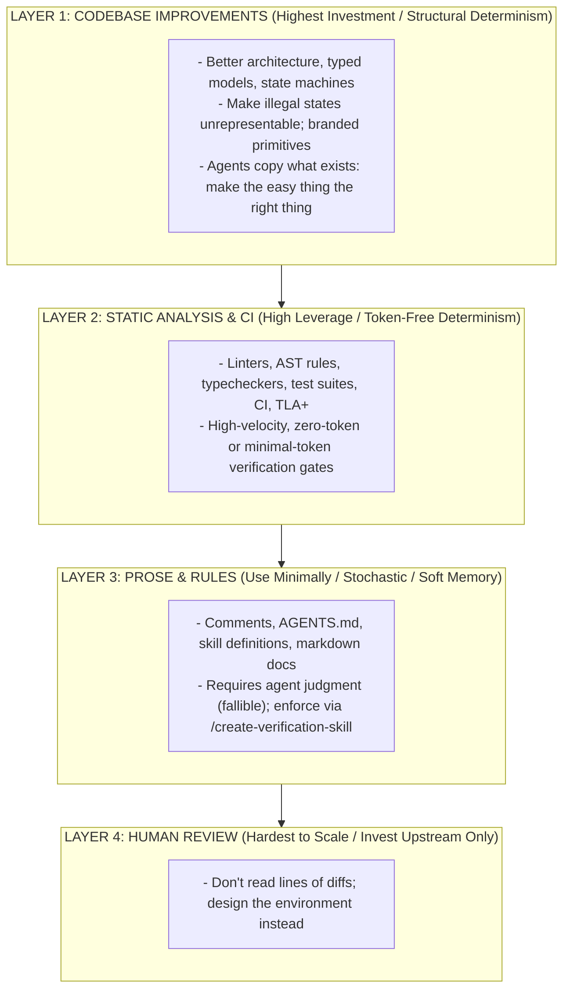
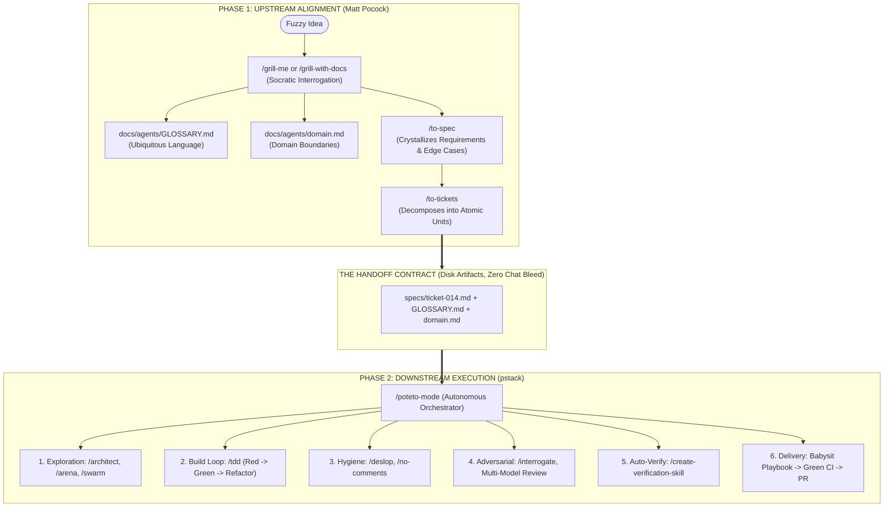
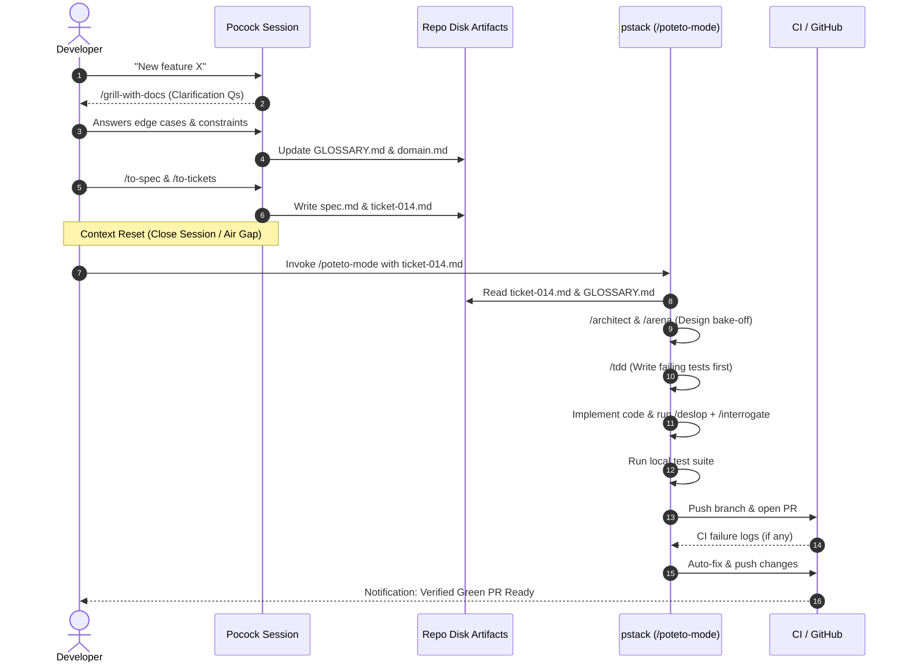
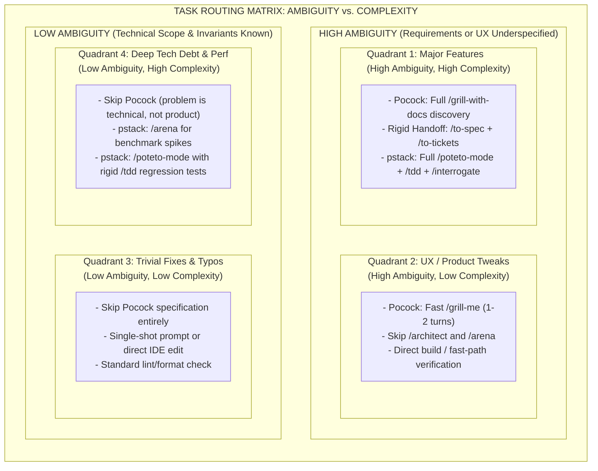
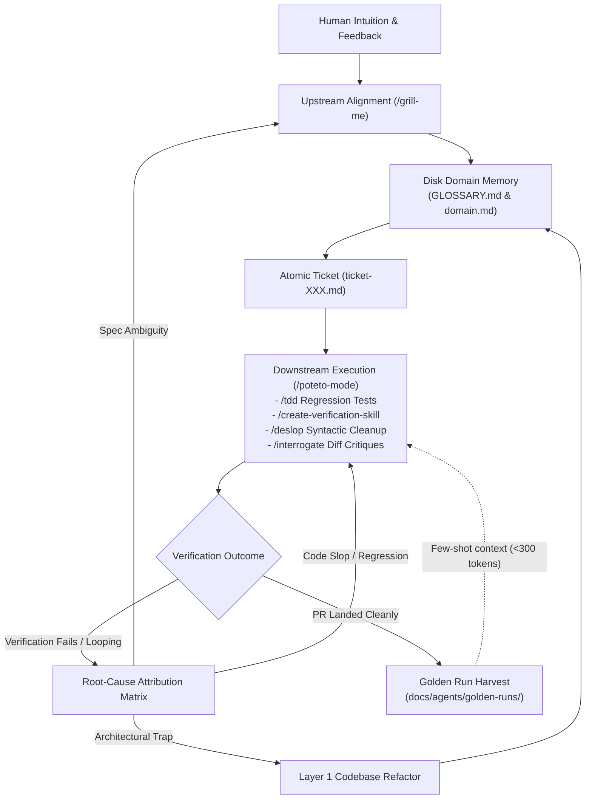

# Architectural Brief: The Hybrid Agentic Development Pipeline

**Combining Matt Pocock’s Upstream Alignment Skills with Poteto’s `pstack` Execution Engine**

## 1. Executive Summary

Modern agentic software engineering breaks down at two distinct fault lines:

1. **The Ambiguity Fault Line (Human** $\leftrightarrow$ **Agent):** Agents build the wrong thing because product requirements, edge cases, and domain boundaries were underspecified.

2. **The Verification Fault Line (Agent** $\leftrightarrow$ **Codebase):** Agents produce unverified, "sloppy" code, get stuck in naive loops, or require constant human babysitting to pass CI and land PRs.

Combining **Matt Pocock’s Agentic Skills** with **Poteto’s `pstack`** creates a full-lifecycle engineering harness. Pocock’s toolkit acts as the **Upstream Product & Domain Compiler**, translating fuzzy human intent into rigid specifications and ubiquitous domain language. `pstack` acts as the **Downstream Autonomous Execution Engine**, taking those specifications and executing them through multi-agent swarms, adversarial code reviews, strict verification ladders, and automated PR management.

Underpinning this entire system is **Poteto’s Inverted Pyramid of Agent Trust**: the recognition that agents are lazy pattern-matchers that copy existing code and greedily take the shortest path. Therefore, the highest-leverage engineering work is not micromanaging prompts or manually checking PR diffs, but **rearchitecting the codebase so that the shortest path is deterministically the correct path**.

## 2. Core Philosophy: The Inverted Pyramid of Agent Trust

A common failure mode in agentic development is spending endless hours writing 5,000-token prompt rulebooks (`AGENTS.md`, `.cursorrules`) and manually reviewing PR diffs line by line. As formulated by Poteto, true trust in autonomous agents requires an **Inverted Pyramid of Effort**, shifting investment from unscalable soft mechanisms to deterministic structural guarantees:



### The Four Layers in the Hybrid Architecture:

1. **Layer 1: Codebase Improvements (Highest Investment / Structural Determinism)**

   * **The Law of Agent Laziness:** Agents love to copy what exists and take the shortest path. If your repo has scattered conditionals, loose `any` types, or ambiguous state management, agents will duplicate those anti-patterns.

   * **The Strategy:** Make the easiest path the correct path. Encode domain invariants into strict type systems, branded primitives, state machines, and pure functional boundaries. When illegal states are physically unrepresentable in the type system, the agent cannot write invalid business logic.

2. **Layer 2: Static Analysis & CI (High Leverage / Low Token Cost)**

   * Deterministic compilers, linters, strict module boundaries, and unit tests catch regressions instantly without burning LLM tokens on subjective interpretation. Feedback is instant, mathematical, and non-negotiable.

3. **Layer 3: Prose & Textual Guidance (Use Minimally / Soft Guardrails)**

   * Natural language rules (in `CLAUDE.md`, `GLOSSARY.md`, or skill prompts) cannot be mechanically enforced; they rely on stochastic LLM judgment.

   * **The Hybrid Rule:** Treat prose as a temporary staging ground. Use Pocock's upstream grilling to extract domain concepts into prose, but immediately convert that prose into Layer 1 types and Layer 2 tests via `pstack`'s `/create-verification-skill`.

4. **Layer 4: Human Review (Hardest to Scale / Environment Designer Role)**

   * At the velocity agents produce PRs, humans cannot review every line of code. Human effort must be pulled out of downstream code review and redeployed upstream into **environment design**—crafting the specs, the verification harness, and the domain architecture.

## 3. System Architecture & Division of Labor

To prevent prompt bloat, conflicting system instructions, and token waste, Pocock and `pstack` operate in **strictly non-overlapping phases** separated by a physical artifact boundary (the **Handoff Contract**).



## 4. Detailed Phase Breakdown

### Phase 1: Upstream Alignment & Domain Modeling (Matt Pocock)

* **Objective:** Eliminate specification ambiguity before a single line of application code is written.

* **Mechanism:** Instead of asking the LLM to guess requirements, the agent aggressively interviews the developer, cross-referencing existing codebase documentation.

* **Key Skills Used:**

  * `/grill-me` / `/grill-with-docs`: Forces decisions on edge cases, state transitions, and failure modes.

  * `GLOSSARY.md` maintenance: Ensures domain concepts have a $1:1$ mapping with variable, type, and table names.

  * `/to-spec` & `/to-tickets`: Generates atomic, dependency-ordered implementation tickets.

### The Handoff Contract (The Air Gap)

Once Phase 1 is complete, **clear the context window / close the chat session**. Do not carry the messy Socratic brainstorming history into the coding agent. The coding agent should only ingest the pristine markdown artifacts written to disk:

1. **`GLOSSARY.md` & `domain.md`**: The immutable laws of the repository's domain.

2. **`ticket-XXX.md`**: Contains Context, Acceptance Criteria, Out-of-Scope boundaries, and **Explicit Verification Commands**.

### Phase 2: Autonomous Execution & Verification (`pstack`)

* **Objective:** Turn a locked specification into production-grade, verified, and merged code with zero human hand-holding.

* **Mechanism:** `pstack` uses structured playbooks and subagent orchestration to explore, test, critique, and ship code against hard exit criteria.

* **Key Skills & Playbooks Used:**

  * `/poteto-mode`: The primary autonomous router. Reads the ticket, selects the appropriate playbook, populates the checklist, and delegates to specialized subagents.

  * `/architect` & `/arena`: Explores design alternatives and benchmarks competing spikes against repo conventions.

  * `/tdd`: Enforces writing failing reproduction or feature tests prior to touch-editing application code.

  * `/create-verification-skill`: Converts task-specific invariants into a persistent, reusable validation script for static verification.

  * `/deslop` & `/no-comments`: Strips AI-generated boilerplate, defensive over-engineering, and redundant inline comments.

  * `/interrogate`: Runs an adversarial review panel over the git diff to catch subtle edge cases or spec deviations.

  * **Babysit / Shipping Playbooks:** Pushes the branch, monitors GitHub Actions/CI, pulls failure logs, pushes fixes autonomously, and prepares the stacked PR.

## 5. End-to-End Sequence Diagram



## 6. Repository Directory & Artifact Structure

```
project-root/
├── .cursor/ or .claude/
│   ├── rules/                      # Core repository rules (always loaded, kept minimal)
│   └── skills/                     # On-demand Pocock skills & pstack plugins
├── docs/
│   ├── agents/
│   │   ├── GLOSSARY.md             # [Pocock -> pstack] Ubiquitous language definitions
│   │   ├── domain.md               # [Pocock -> pstack] Core domain models & invariants
│   │   ├── architecture.md         # [Pocock -> pstack] System boundaries & tech stack
│   │   ├── audits/                 # [pstack] Agent-friendliness refactoring audits
│   │   ├── retrospectives/         # [pstack -> Pocock] Run failure post-mortems
│   │   └── golden-runs/            # Exemplar ticket -> PR pairs for few-shot guidance
│   └── specs/
│       └── 2026-10-auth-refactor/
│           ├── spec.md             # [Pocock] Master specification from /to-spec
│           ├── ticket-01.md        # [Pocock -> pstack] Atomic execution unit
│           └── ticket-02.md        # [Pocock -> pstack] Atomic execution unit
└── src/
```

## 7. The Anatomy of a Handoff Ticket

For `/poteto-mode` to operate at peak efficiency, Pocock’s `/to-tickets` skill outputs tickets matching `pstack`’s expectation of **observable exit criteria** and **pinned context**:

```markdown
# Ticket 01: Implement Idempotent Webhook Processor

## Ubiquitous Language Refs
- Must strictly adhere to `WebhookEnvelope`, `IdempotencyKey`, and `IngestionReceipt` as defined in `docs/agents/GLOSSARY.md`.

## Problem & Goal
Duplicate Stripe events are causing double-credits. Implement an idempotent lock mechanism at the ingestion boundary.

## Target Files (Context Pinning)
- Read/Modify: `src/webhooks/stripe-handler.ts`, `src/webhooks/types.ts`
- Test Target: `src/webhooks/__tests__/stripe-handler.test.ts`

## Requirements & Invariants
1. Check `IdempotencyKey` in Redis prior to domain dispatch.
2. If state is `PROCESSING`, return HTTP 409.
3. If state is `COMPLETED`, return HTTP 200 with cached `IngestionReceipt`.
4. Make invalid states unrepresentable: model transitions as a strict TypeScript discriminated union.

## Out of Scope
- Do not modify the downstream `BillingLedger` service.

## pstack Exit Criteria (Verification Ladder)
- [ ] Unit tests covering concurrent duplicate payloads (`pnpm test src/webhooks`).
- [ ] Zero TypeScript errors (`pnpm typecheck src/webhooks`).
- [ ] Diff passes `/deslop` and `/no-comments` hygiene checks.
- [ ] Adversarial review passes via `/interrogate`.
```

## 8. Routing Matrix: Sizing the Workflow to the Task



### Execution Strategy by Quadrant:

* **Quadrant 1: Major Features (High Ambiguity, High Complexity)**
  1. Pocock: `/grill-with-docs` for extensive domain discovery.
  2. Pocock: `/to-spec` and `/to-tickets` to establish rigid handoff artifacts.
  3. `pstack`: Full `/poteto-mode` autonomous swarm, TDD, adversarial interrogation, and CI babysitting.

* **Quadrant 2: UX / Product Tweaks (High Ambiguity, Low Complexity)**
  1. Pocock: Fast `/grill-me` (1–2 turns) to nail design specifics.
  2. Direct implementation: Bypass `/architect` and multi-model arena reviews.

* **Quadrant 3: Trivial Fixes / Typos (Low Ambiguity, Low Complexity)**
  1. Skip Pocock entirely (requirements are self-evident).
  2. Single-shot prompt or direct IDE edit.

* **Quadrant 4: Deep Tech Debt / Perf (Low Ambiguity, High Complexity)**
  1. Skip Pocock (problem is technically constrained, not product-ambiguous).
  2. `pstack`: Run `/arena` for competitive benchmarking spikes.
  3. `pstack`: Execute via `/poteto-mode` with rigid regression testing via `/tdd`.

## 9. Token Economics & Cost Optimization

Both Pocock's interrogation loops and `pstack`'s multi-agent panels are token-intensive. Running them naively multiplies burn by $3\text{--}5\times$. The following levers compress consumption by $60\text{--}75\%$:

```mermaid
flowchart TD
    subgraph Unoptimized ["UNOPTIMIZED PIPELINE (High Token Burn: 3-5x Baseline)"]
        direction LR
        U1["15-Turn Grill<br/><i>(Context bloat)</i>"] --> U2["Full Repo Scan<br/><i>(Reading 50+ files)</i>"]
        U2 --> U3["/arena + /architect<br/><i>(Redundant design)</i>"]
        U3 --> U4["Full Test Suite Logs<br/><i>(10k+ token stdout)</i>"]
    end

    subgraph Optimized ["OPTIMIZED PIPELINE (Compressed Budget: 60-75% Savings)"]
        direction LR
        O1["3-Turn Batched Grill<br/><i>(Batched Q&A)</i>"] --> O2["Hard Context Reset<br/><i>(Disk Artifact Handoff)</i>"]
        O2 --> O3["Pinned File Paths<br/><i>(Direct to /tdd)</i>"]
        O3 --> O4["Silent Test Wrappers<br/><i>(Failures/diffs only)</i>"]
    end
```



1. **The Hard Air Gap:** Never write code in the spec session. Clear context after `/to-tickets`. Ingest only the $500$-token ticket into `/poteto-mode`.

2. **Context Pinning in Tickets:** Explicitly list target files and function signatures in the ticket. Instruct `/poteto-mode`: *"Architecture and target files are locked. Skip `/architect` and `/arena`; proceed directly to `/tdd`."*

3. **Batched Grilling:** Instruct `/grill-me`: *"Ask a maximum of 4 high-impact clarifying questions grouped in a single list, then immediately synthesize `/to-spec`."*

4. **Dynamic Skill Loading:** Store skills on-demand (`.claude/skills/` or Cursor rules with `alwaysApply: false`). Keep global system instructions under $150$ lines.

5. **Tiered Model Routing:** Use Frontier Reasoning (Opus/Sonnet Thinking) for Pocock grilling and `pstack` `/interrogate`; use Fast/Small models (Flash/Haiku) for file search and `/deslop`.

6. **Silencing Verification Logs:** Run test commands with `--reporter=dot` or `--silent` and `tsc --pretty false` so stdout consumes tokens only on failure.

## 10. The Compounding Flywheel & Agent-Friendly Codebase Retrofitting

The fundamental principle of this hybrid pipeline is: **Stateless Agent, Stateful Environment**. Because LLM weights are static, learning must be externalized into the codebase.

In accordance with Poteto’s Inverted Pyramid, the ultimate flywheel converts human review signals into **Layer 1 architecture improvements** and **Layer 2 static verification**, shrinking Layer 3 prose to the bare minimum.



### The "Agent-Friendly Codebase" Retrofit Protocol (Poteto Project Template)

To jumpstart a repository or systematically eliminate recurring agent errors, run Poteto's dedicated retrofitting loop using `pstack`:

```markdown
/poteto-mode Execute codebase agent-friendliness audit:
1. Ingest human feedback: Read recent Slack/chat threads and PR review comments where senior engineers provided feedback on architecture, types, and recurring bugs.
2. Mine steering history: Run /recall on past transcripts to extract common manual interventions and corrections.
3. Discover pitfalls: Run /correct and /architect on past commits to isolate the top 5 structural traps agents fall into.
4. Synthesize refactoring plan: Propose architectural improvements (Layer 1) to eliminate these failure classes permanently. Answer open questions through rapid prototyping and back the plan with concrete data.
5. Verify prompt alignment: Before modifying application code, run /sharpen and /in-your-own-words to confirm requirements with me.
```

### Institutionalizing the 4 Learning Loops:

1. **Upstream Epistemic Memory (`GLOSSARY.md`):** Corrections made during `/grill-me` update domain vocabulary on disk. Because future agents ingest `GLOSSARY.md`, conceptual and naming mistakes are eliminated at the source.

2. **Deterministic Mechanical Memory (`/tdd` & `/create-verification-skill`):** Every feature developed by `pstack` leaves behind a test suite and an automated verification skill. Future agents are instantly held accountable by deterministic code, not decaying prompt rules.

3. **The Root-Cause Attribution Matrix:** When a PR fails review or an agent loops, attribute the failure to its true root cause:

   * *Spec Ambiguity* $\rightarrow$ Patch the interrogation prompts in Pocock's `/grill-me`.

   * *Context Starvation* $\rightarrow$ Enforce target file pinning in `/to-tickets`.

   * *Code Slop* $\rightarrow$ Add an automated AST rule or regex check to `pstack`'s `/deslop`.

   * *Architectural Trap* $\rightarrow$ Refactor domain types (Layer 1) to make the error impossible.

4. **Golden Run Harvester:** Archive pristine Ticket $\to$ PR diff pairs into `docs/agents/golden-runs/`. Referencing a single golden run gives future agents instant few-shot behavioral alignment for under $300$ tokens.

## 11. Implementation Checklist & Guardrails

1. **Adhere to the Inverted Pyramid:**

   * Never try to fix with a prompt rule (Layer 3) what can be fixed with a strict TypeScript type (Layer 1) or an automated linter (Layer 2).

2. **Resolve Skill Collisions:**

   * Disable Pocock’s code-review and execution skills. Use Pocock **exclusively** for pre-code interrogation, domain glossary curation, and ticket generation.

   * Use `pstack` **exclusively** for code exploration, TDD, code hygiene (`/deslop`), adversarial diff review (`/interrogate`), and PR shipping.

3. **Enforce Vocabulary Checks in `pstack`:**

   * Standing instruction in `pstack`: *"Before writing code, read `docs/agents/GLOSSARY.md`. Any new types or variables that conflict with or duplicate existing glossary terms will fail `/interrogate`."*

4. **Enforce the Context Air Gap:**

   * Never transition from `/to-tickets` to `/poteto-mode` in the same thread. Start a clean agent session pointed at the markdown ticket.

5. **Run the Codebase Retrofit Protocol Periodically:**

   * Every sprint or month, run the `/correct` + `/architect` audit over recent PR comments to identify code patterns that confuse agents, and rearchitect them into agent-friendly primitives.