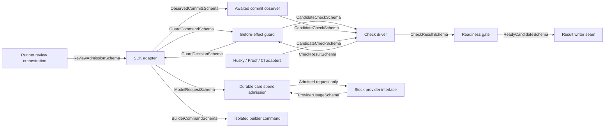

> *This was generated by AI during triage.*

## Outcome

Julia's runner makes the builder follow the installed framework while building: a broken adopted framework fact blocks commit and readiness.

## Requirements

Todd’s 22 October 2026 11:18 PT decision supersedes the historical replacement entries below: current machinery allowlist is reflection/beam:free only; real review remains deepseek/deepseek-v4.1-flash. Ornith was charged $0.0297 and is refused; Glyph remains dropped. Prior DeepSeek $0.4527 plus Ornith $0.0297 settles all reservations at $0.4824, all monthly allowance, under the shared $1 cap. Record each completed response’s cost immediately; no further human receipt lookup. Fix the actual caller bypass and finish JUL-250 through merge under the 09:52 decide/record/continue rule.

Latest standing-rule replacement — 22 October 2026 17:12 UTC: Glyph (`stealth/glyph-cluster:free`) became unavailable with HTTP 429; Laguna’s one replacement attempt also returned HTTP 429. Current machinery model is Ornith (`ornith/ornith-1.5-122b`): CommandCode’s current GOAT pricing page explicitly lists “Free on Ornith 1.5 122B” ([https://commandcode.ai/pricing](<https://commandcode.ai/pricing>)), and its real request returned HTTP 200. Exact ID is also published on the official Available Models page. Retain `docs/agents/jul-250/evidence/2026-10-22-fixture-fix/ornith-replacement-response.json`. The retail model profile lists nominal paid rates separately; this switch follows Todd’s plan-free-listing/one-HTTP-200 rule, with any later nonzero usage-page cost stopping the card. All operative Beam/Glyph machinery references now mean this current model under that rule; original observations remain historical. No further requests to the unavailable models; real builder/reviewer choices unchanged.

Standing free-model rule applied — 22 October 2026: Beam (`reflection/beam:free`) returned HTTP 429. Machinery checks switch to Glyph Cluster (`stealth/glyph-cluster:free`), listed free on CommandCode’s Pricing & Limits page and proven HTTP 200 at 17:00 UTC. See docs/agents/JUL-250/evidence/2026-10-22-fixture-fix/replacement-response.json. In operative requirements, Beam denotes the current machinery model under this standing rule; historical evidence remains historical. Real builder/reviewer choices remain Todd’s.

Todd’s latest 22 October 2026 decision supersedes the dedicated-account decision: continue as ubuntu on the existing connection; julia-agent stays in place unused. The builder’s admin access, ability to read the control-page pass, change runner limits and use deployed-code access are accepted risks. No new protection against these risks is required. Keep functional model/cost/key-environment/review admission behavior already requested; do not claim it resists an admin changing the code or configuration. Todd's decision — 22 October 2026 09:52, superseding every other stop trigger on this card and in AGENTS.md: ask Todd only when (1) the next step physically requires Todd himself, such as signing in or clicking in one of his accounts, and work cannot continue without it; (2) spending would exceed the cap; or (3) it is a choice about what Julia does for the household. Decide everything else yourself, including security, credential and risk judgments, using Todd's standard: accept unlikely risks; act only on actual harm or misuse. Record the decision in one line on the card and continue. When unsure whether something needs Todd, decide and record it. Ordinary errors are diagnosed and fixed in place. JUL-250 merges first, then this card, then restart JUL-231.

Todd’s decision — 22 October 2026 07:56: learning tests check framework facts, not model behavior. Hooks, guards, local refusals, settings, memory switches and push handling issue actual tool calls or requests directly through the installed framework’s public interfaces, with no model in the loop. Their results cannot depend on which model is configured; no prompt wording steers a model into the call. A real model is used only where its side is the subject: real request resolution, a refusal reaching the model as a valid tool result without a provider error, and feedback reaching the model. Keep these few, on Beam under the standing free-model rule. If the model does not attempt the expected step, record “model did not attempt” as inconclusive and rerun once; it is never a pass or failure of the guard. Unresolved inconclusive evidence cannot satisfy Proof. Show each rewritten test red with its guard broken, green after restoration and rerun the complete suite through op run. Record this pointer in the existing TDD mocking guidance without rewriting the general guidance.

Todd’s decisions — 22 October 2026 07:35–07:44: learning tests and Proof drives use one free model, Reflection Beam Free (`reflection/beam:free`). Requirements naming “Beam in learning/Proof drives” or “both free builders” now mean Beam alone. Drop MiniMax, Laguna and Glyph Cluster. Beam is already proven free: Claude read Todd’s CommandCode usage page at 06:58 on 22 October and saw $0.0000 for each Beam request. Todd accepts that evidence; no further cost proof or usage-page polling is required.

Standing rule: in learning tests and Proof drives only, if the free model becomes unavailable, the agent picks another model that CommandCode’s billing page lists as free, records the old and new exact IDs in this card’s evidence and continues. Do not wait on the usage page or retry unavailable models; one HTTP 200 is enough to switch. If the usage page later shows any cost for that model, the adapter refuses that model from then on and the card stops. Paid models remain Todd’s decision.

This rule never applies to real work. Real card building uses Todd’s chosen builder, Codex GPT-6 Sol; real review uses Todd’s chosen reviewer, DeepSeek via CommandCode, under the $1.00 per-card cap. Changing either is Todd’s decision. The adapter refuses free models for real build and review roles. Its CommandCode allowlist covers Beam for machinery checks only and the reviewer’s single paid model (`deepseek/deepseek-v4.1-flash`), with purpose/role checked before dispatch. The real Codex builder is not silently replaced by a free model.

Todd decision — 22 October 2026 07:04–07:08: spending control lives in Julia's runner, not provider accounts. CommandCode's approximately $84 exposure ($80 monthly allowance plus $4.30 credit) is not an acceptable cap. The stock SDK adapter is the only route to paid models. Before any outbound inference, it refuses every model outside a committed allowlist covering Beam for learning/Proof roles only plus the reviewer’s single paid model. Purpose and role are checked before dispatch; free models are refused for real build/review. Machinery replacement follows the standing billing-page-free/one-HTTP-200 rule above. No automatic replacement of Todd’s real builder/reviewer or extra paid memory model.

The adapter maintains a durable per-card cost total from provider usage covering builds and reviews together, including retries and memory calls. Beam machinery calls count as $0 using Todd’s accepted usage-page evidence; a later usage-page cost stops the card and permanently refuses that model. It refuses the next paid request at $1.00 and refuses unknown cost. Serialize admission and settlement per card; persist an in-flight reservation before dispatch, bound each paid request by remaining budget, and reconcile provider usage before further paid requests. Missing, malformed or unreconciled usage after timeout/crash leaves cost unknown and blocks paid dispatch across restart; no reset, parallel request or review can evade the shared total. Provider token counts alone are not a dollar readback without authoritative pricing; an unbounded request is refused before dispatch.

Provider keys exist only inside the adapter process; never persist plaintext provider keys in settings, run files or builder-readable configuration. Use the SDK's public runtime custom-provider source, not file-backed apiKey settings, for secret-bearing resolution. Every builder command receives an environment without provider keys or the vault service-account token, including nested commands; no inherited key or authentication fallback. The adapter supplies builder commands an environment without provider keys. Todd accepts that the admin builder can read other credentials, change the adapter/limits or use another route; no OS isolation, tamper protection or proof against those accepted risks is required.

Only the runner starts reviews, only after ready-for-review, with at most two review rounds per card. Durable round admission is persisted before launch, serialized with the card, and survives restart; retries do not create an uncounted review. Builder-initiated review and a third round are refused before any reviewer/model request. A third-round attempt stops the card under AGENTS.md. Until this card merges, JUL-250 permits CommandCode only in retained Beam machinery learning tests under the standing rule, with accepted cost evidence.

**Todd decision — 22 October 2026 05:31:** JUL-250 creates the permanent server agents key route. This guardrails card stays parked in Backlog until JUL-250 merges, then resumes on its server op run route as ubuntu with the agents-only pass and committed op:// references. Do not use the protected control-page pass or the retired learning helper. Windows vault launcher applies only to commands actually run on the laptop.

Todd approved Shape at 5d37cfd (docs/agents/framework-guardrails-shape-2026-10-21.md), dated 21 October 2026 22:46, with the binding ownership, Auto memory and memory-test changes recorded here. This is the guardrails core build, based on main. The card owns the stock SDK adapter under ops/build-runner, its own committed package-lock.json installed by npm ci in that directory, and all three runner layers. Verify installed versions against that owning lockfile; no root install or another checkout's node_modules counts as runner installation proof. SDK research used 1.14.0; the adapter is its only production importer. Nothing is carried over from julia-build/JUL-231 except through an approved restart. JUL-231 stays parked; its later approved rebuild consumes this core and owns only Start-to-saved-result.

Use Mastra stock Auto for both memory roles, observational memory on, with stock thresholds and buffering. With the free custom CommandCode builder, Auto uses that free builder at $0. No paid memory model or separate memory spend is authorized by this card. The free machinery layer drive uses Beam alone under the standing rule above; its test roles do not choose the real builder or reviewer. The shared build-and-review cap is $1.00 per card; this latest dated decision supersedes earlier separate role budgets for this card; accepted ADRs and Todd's dated decisions own limits. Do not run paid inference outside those decisions.

Framework Map is framework/<package>/, preserving scopes. Learning-test headers name owning-lockfile version, exact documentation page/declaration and observed fact. Adopt SDK facts first; repository lint applies immediately; touching another importer requires its package tests, without bulk tests for untouched imports. Tests use public interfaces and real outside services; only clock, randomness and owned temporary directories may be controlled. Provider/setup/credential unavailability fails and is retained. Add the learning-test pointer to the existing TDD mocking guidance without rewriting that guidance.

One runner-owned check driver serves runner, outside-runner Husky, Proof admission and CI. Keep stock Mastra hooks enabled. No vendor-specific Codex hook and no fourth after-write layer. Stop policy is Todd's 09:52 rule above: decide and record everything except the three cases it names. Spend limits still bind. Preserve permanent prerequisites and evidence. The adapted Windows runner's complete suite must pass on Todd's laptop before delivery use.

Read the Framework Map comment before building.

## Contracts

Each named schema is defined once in the runner core and shared by the offering and using modules. They describe the new core, not an existing implementation.

GuardCommandSchema carries command, cwd, Git context and candidate-affecting environment. Adapter offering check preserves the actual tool-call identity/input; guard using check refuses bypass/opaque interpretation before any effects. GuardDecisionSchema carries allow/refuse and broken fact/docs feedback; guard offering check maps failed/unavailable/deadline/setup outcomes to blocking exit 2, and adapter using check proves the real builder receives a valid tool-result refusal through public inputProcessors/processLLMRequest without replacing stock processors or inventing a model response. Stock exit 1/timeout warn-and-allow is insufficient.

CandidateCheckSchema identifies frozen Git candidate, owning lockfiles and applicable checks; guard/observer/outside-runner offering checks compare actual Git identity, and driver using checks operate on exactly that content. CheckResultSchema binds each result to candidate identity, check identity, status and broken fact/documentation. Driver offering check retains actual exits; guard/readiness using checks reject wrong identity, failure and absence. ObservedCommitsSchema enumerates every new SHA; adapter offering and observer using checks demonstrate both commits in one call are checked while work is active and before the next model step. ReadyCandidateSchema binds a passing SHA to its own complete results; gate offering and writer using checks reject stale, failed or missing results, including after process restart. Durable results are revalidated by exact identity; no earlier pass grants a later candidate readiness. This seam does not build JUL-231's Start/page journey.

ModelRequestSchema binds card, role, exact model, request identity and finite cost bound; ProviderUsageSchema binds the same request to known cost or explicit unknown status. Adapter offering checks attempt an unlisted model; spend admission using checks prove no outbound request on refusal. Provider offering checks retain actual usage and cost readback; spend using checks settle the correct card once, refuse unknown cost, and preserve totals/in-flight uncertainty across restart. ReviewAdmissionSchema binds card, ready candidate, runner authority and durable round; runner offering checks launch only after ready-for-review, adapter using checks reject builder authority and round three. BuilderCommandSchema carries argv/cwd and a secret-free environment; adapter offering and actual child using checks look for provider keys and find none, including nested commands. Schemas are Julia-owned and defined once. SDK/provider wire interfaces remain stock.

When any shared schema or its ordering/error/restart rules change, rerun checks on every offering and using module named above, including Husky, Proof and CI. SDK wire payloads stay stock; these schemas govern Julia-owned seams.

## Acceptance criteria

1. Model admission, shared cost and key isolation are enforced by the stock SDK adapter as described above. Prove with real attempts: disallowed model before network; paid request at the $1.00 card cap; unknown cost; and a builder command looking for provider keys and finding none. Retain refusals, outbound-attempt counts, durable cost/restart readback and actual child output; cap/unknown/disallowed refusal cases must incur no paid request. Prove builds/reviews share one total and free requests count $0. The main-based core runs through the stock SDK adapter installed from its own lockfile; conforming adopted SDK facts pass through real request resolution. Proof covers installation/version readback, thread-before-saved-model selection, settings-to-real-inference, and applicable assertions rejecting historical regressions f50e509, 1cc879d and 92f337d. Auto memory stays on with stock settings at $0. The observational-memory learning test runs only for changes to memory configuration, the observational-memory switch, or @mastra/code-sdk/@mastra/core versions, and in CI on main. Its first free-model run occurs in this guardrails build when memory is configured. That run must show observation, reflection, condensed context used by a later real request, recall absent from raw history, and an off-case with neither agent running; broken on/off guards fail their assertions. A failure is a problem to diagnose and fix test-first under the stop rule, not a reason to defer memory. All applicable retained learning tests pass together in one invocation; unrelated changes omit only this conditional memory test. Proof covers each trigger, a non-trigger, and main CI scheduling.
2. Framework lint and coverage refuse each nonconforming candidate and accept conforming candidates. Proof covers real ops/scripts sources; direct imports outside adapters, forbidden switches/settings paths/disabled stock features, outside-service fakes, missing adopted/touched tests, ignored trees, version/header mismatches, missing typechecks and unlimited importer exemptions all refuse admission. Conforming scoped imports, reexports, dynamic imports, require forms, subpath-to-package normalization and importer-owning-lockfile resolution pass. Every scoped exception names reason and documentation. Missing setup/credentials is failure, not regression proof.
3. Layer 1 refuses bypass before any effect. Direct public-framework Proof without a model covers baseline bypass options, arbitrary/trailing option positions, compound commands with earlier sentinel effects, message substrings versus commit -n, push dry-run versus commit bypass, and opaque commands. Actual hook/model and Git/sentinel/push readbacks prove refusal precedes effects.
4. Layer 2 checks exactly what Git will commit and independently refuses failed learning tests, framework lint, coverage and typecheck, returning the actual broken fact/docs link through the tool result; the few Beam-side checks separately prove valid feedback arrival without provider error; a conforming candidate commits. Proof covers staged/unstaged divergence, alternate indexes, path-limited commits, -a, amend and candidate-changing compound commands: each gets exact checks or refusal before effects, including a broken staged candidate with a conforming working copy. Failure/unavailable/deadline/setup block via exit 2.
5. Runner-only review admission follows ready-for-review and allows at most two durable rounds. Prove with real attempts that builder-initiated review and a third review round are refused before launch/model effects; the third stops the card. Prove not-ready refusal and round preservation across restart/concurrent admission; no caller-supplied role string grants authority. Layer 3 awaits observation and checks every resulting SHA while the builder is active. Proof covers multiple commits in one call, ordering before the next model step, failed/missing/stale results refusing persistence, observer exceptions not granting readiness, and a new passing candidate needing its own results. Exact-SHA readback and restart readback prove the gate rejects stale durable results.
6. Outside-runner Husky, Proof admission and CI use the same driver on the exact candidate. Proof demonstrates each entry point's pass/refusal and the actual GitHub push outcome through ordinary signed-in GitHub with an explicit destination; a local bare-origin push is capability evidence only. Remove the superseded pre-plan Framework Map comment instructions, Start's map-comment admission/loading and CODING_STANDARDS' old map checks; historical map comments grant no admission. This pre-plan retains today's required Map until those rules are replaced by the built guardrail.

## Proof

One guardrail proof story: issue actual tool/command requests for the same conforming and deliberately broken candidates directly through the framework public interfaces for all three layers and other driver entry points, without a model. Use Beam only for actual provider request resolution and valid refusal/feedback reaching the model. Apply the once-only inconclusive rerun rule for a missing model step. Each numbered criterion above enumerates its required cases; retain command, exit, effect/readback, exact candidate commit and dirty-tree digest for every case. See each test fail against the broken behavior before the fix, pass after, and have the reviewer rerun it. No mock/stub/fake across a seam counts. No UI mockup is delivered, so numbered mockup callouts do not apply.

Include formal verification of check-before-effect, candidate identity, stale results, readiness, cost admission/settlement and review-round restart ordering using create-formal-verification-skill and maintain-formal-verification-skill, in addition to the real drive. Use project-local adversarial-review followed by docs/agents/machine-pstack-verification.md and verify-machine. Extend the verification map through maintain-verification-skill for this new core before Proof. Only after passing review/Proof, publish the exact candidate through one PR, wait for its CI, merge this machine card and confirm main contains it. Record reports/evidence under docs/agents/<card>/ and push before reporting. This card's implementation finish includes publishing the core on main; its present pre-plan does not start delivery.

## Runtime dependency matrix

These rows fill the real dependency/proof details of AC1, AC5 and AC6. They do not authorize deploying the parked runner or using the unverified adapted delivery launcher.

| Handoff | Principal | Backing store or interface | Mode | Real fixture and proof |
| -- | -- | -- | -- | -- |
| SDK adapter to CommandCode | Adapter process alone receives provider key; builder commands receive no provider keys or service-account token | Real CommandCode provider endpoint through stock SDK runtime custom-provider source | Inference | AC1/3/4/5 Beam machinery drive, actual resolved model/request/usage/cost readback; allowlist/cap/unknown-cost refusals before network; no paid-memory override |
| SDK memory to storage | Same runner principal, writing only its owned run/thread data | Stock SDK local LibSQL memory store in the run-owned directory | Read/write | AC1 on/off observation/reflection/condensed-context/recall drive; actual persisted thread and later request readback |
| Guard/observer to Git and check results | Same runner principal in its owned worktree | Real Git index/objects and run-owned exact-identity result records | Read/write | AC3/4/5 command/exit/effect/readback on actual candidates; persisted stale-result restart readback |
| Publication to GitHub | Ordinary signed-in GitHub identity, explicit repository/branch destination | GitHub Git and PR/CI | Read/write | AC6 actual push outcome, exact reviewed commit PR/CI and main merge readback; never infer from a local bare origin |

## Out of scope

JUL-231 Start-to-saved-result journey, control-page work, retired Factory, vendor-specific runner hooks, immediate after-write feedback, bulk tests for untouched imports, paid memory pins, and carrying the stopped JUL-231 implementation without approved restart.

## Admission result — 22 October 2026

Todd settled at 05:20 and accepted the schema run as this card's admission. Claude's independent 05:18 check passed (zod 3.25.76 zod/v4). Server rerun with main 2ba10cf and reviewer lockfile-installed Zod 4.6.5 passed on the complete fresh card/comments; removing Acceptance criteria failed with “missing nonempty Acceptance criteria section”. See the Admission comment and committed evidence. This supersedes the earlier launcher-only blocker.
