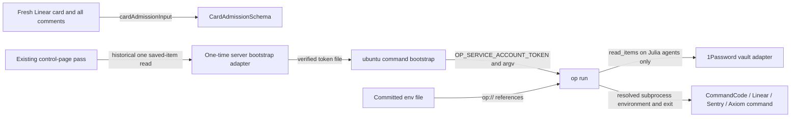

> *This was generated by AI during triage.*

## Outcome

Agents on the server can run keyed commands through one isolated 1Password op run route as ubuntu using the copied agents-vault pass.

## Requirements

Latest standing-rule replacement — 22 October 2026 17:12 UTC: Glyph (`stealth/glyph-cluster:free`) became unavailable with HTTP 429; Laguna’s one replacement attempt also returned HTTP 429. Current machinery model is Ornith (`ornith/ornith-1.5-122b`): CommandCode’s current GOAT pricing page explicitly lists “Free on Ornith 1.5 122B” ([https://commandcode.ai/pricing](<https://commandcode.ai/pricing>)), and its real request returned HTTP 200. Exact ID is also published on the official Available Models page. Retain `docs/agents/jul-250/evidence/2026-10-22-fixture-fix/ornith-replacement-response.json`. The retail model profile lists nominal paid rates separately; this switch follows Todd’s plan-free-listing/one-HTTP-200 rule, with any later nonzero usage-page cost stopping the card. All operative Beam/Glyph machinery references now mean this current model under that rule; original observations remain historical. No further requests to the unavailable models; real builder/reviewer choices unchanged.

Implementation decision under Todd’s 09:52 rule: the latest instruction to finish review and merge uses the already chosen DeepSeek reviewer (`deepseek/deepseek-v4.1-flash`) within the existing $1.00 per-card review limit. This is review of this card, not a paid machinery probe or a replacement model. The earlier learning-only restriction continues to prohibit paid learning requests.

Standing free-model rule applied — 22 October 2026: Beam (`reflection/beam:free`) became unavailable with HTTP 429 in the retained real-request learning check. Switched machinery checks only to Glyph Cluster (`stealth/glyph-cluster:free`), listed free for input/output/cache on CommandCode’s Pricing & Limits page, with a real HTTP 200 at 17:00 UTC. Evidence: docs/agents/JUL-250/evidence/2026-10-22-fixture-fix/replacement-response.json. No usage-page wait or additional cost proof; real builder/reviewer choices remain Todd’s. In operative requirements below, Beam denotes this current machinery model under the standing rule; historical Beam evidence remains historical.

Todd’s latest decision — 22 October 2026: the observed CommandCode-key exposure to Beam is accepted; do not rotate. Continue by fixing the fixture fault as planned, keeping the live key out of settings.json, then finish this card through merge, then JUL-249 through merge, then restart JUL-231. Report only at merges or required account/money/product decisions. This acceptance is specific to the observed exposure; no key or account mutation is requested.

Todd’s latest decision — 22 October 2026, superseding the 08:35–08:37 account decision: continue as ubuntu on the existing connection; leave julia-agent in place, unused. Todd accepts that the builder has admin rights, could read the control-page vault pass, could change runner limits, and could use the deployed-code route. Do not add safeguards, rules, criteria, checks or cards to prevent those accepted risks. Drop the lockdown/dedicated-account criterion and related protective proof. Todd's decision — 22 October 2026 09:52, superseding every other stop trigger on this card and in AGENTS.md: ask Todd only when (1) the next step physically requires Todd himself, such as signing in or clicking in one of his accounts, and work cannot continue without it; (2) spending would exceed the cap; or (3) it is a choice about what Julia does for the household. Decide everything else yourself, including security, credential and risk judgments, using Todd's standard: accept unlikely risks; act only on actual harm or misuse. Record the decision in one line on the card and continue. When unsure whether something needs Todd, decide and record it. Ordinary errors are diagnosed and fixed in place. Replace the matching AGENTS.md stop triggers with this rule in this card's candidate. Applied now: the 09:24 CommandCode key exposure in the learning fixture is accepted; do not rotate. Fix the fixture so the key is never written to settings.json. Report to Todd only at each merge. Finish this key-route card through review, Proof, PR/CI and merge; then build JUL-249 to merge, then restart JUL-231.

Todd’s decision — 22 October 2026 07:56: learning tests check framework facts, not model behavior. Hooks, guards, local refusals, settings, memory switches and push handling issue actual tool calls or requests directly through the installed framework’s public interfaces, with no model in the loop. Their results cannot depend on which model is configured; no prompt wording steers a model into the call. A real model is used only where its side is the subject: real request resolution, a refusal reaching the model as a valid tool result without a provider error, and feedback reaching the model. Keep these few, on Beam under the standing free-model rule. If the model does not attempt the expected step, record “model did not attempt” as inconclusive and rerun once; it is never a pass or failure of the guard. Unresolved inconclusive evidence cannot satisfy Proof. Show each rewritten test red with its guard broken, green after restoration and rerun the complete suite through op run. Record this pointer in the existing TDD mocking guidance without rewriting the general guidance.

Todd’s decisions — 22 October 2026 07:35–07:44: learning tests and Proof drives use one free model, Reflection Beam Free (`reflection/beam:free`). Requirements naming “each real free builder” or “both free builders” now mean Beam alone. Drop MiniMax, Laguna and Glyph Cluster. Beam is already proven free: Claude read Todd’s CommandCode usage page at 06:58 on 22 October and saw $0.0000 for each Beam request. Todd accepts that evidence; no further cost proof or usage-page polling is required.

Standing rule: in learning tests and Proof drives only, if the free model becomes unavailable, the agent picks another model that CommandCode’s billing page lists as free, records the old and new exact IDs in this card’s evidence and continues. Do not wait on the usage page or retry unavailable models; one HTTP 200 is enough to switch. If the usage page later shows any cost for that model, the adapter refuses that model from then on and the card stops. Paid models remain Todd’s decision.

This rule never applies to real work. Real card building uses Todd’s chosen builder, Codex GPT-6 Sol; real review uses Todd’s chosen reviewer, DeepSeek via CommandCode, under the $1.00 per-card cap. Changing either is Todd’s decision. The adapter refuses free models for real build and review roles. Its CommandCode allowlist covers Beam for machinery checks only and the reviewer’s single paid model (`deepseek/deepseek-v4.1-flash`), with purpose/role checked before dispatch. The real Codex builder is not silently replaced by a free model.

Todd decisions — 22 October 2026 05:31, the subsequent 22 October copy-only/server-bootstrap amendment, and 22 October 2026 06:09 four-key decision, supplied in pre-plan: agents work on the server; rules, pre-plan and build steps assume the server. The Windows vault launcher remains only for commands actually run on the laptop. This is one machine card creating the permanent route. JUL-249 stays parked until this card merges, then resumes on the new route. Settlement and Todd's current continue-build authorization remain accepted. The unverified delivery runner is not used.

Two vaults: retain the settled copy-only arrangement. Julia agents contains exactly the copied Julia CommandCode, Julia Linear, Julia Sentry and Julia Axiom key items. Originals remain in Julia; laptop and control-page references/configuration remain unchanged. Other keys and the control-page pass stay outside Julia agents.

Todd decisions — 22 October 2026 07:04–07:08: spending control lives in Julia's runner, not in provider accounts. CommandCode's worst-case account exposure is about $84 ($80 monthly allowance plus $4.30 credit); that is not an acceptable cap. The runner adapter in JUL-249 enforces the shared $1.00 per-card cap. Until JUL-249 merges, keyed CommandCode use is limited to the retained Beam machinery learning tests under the standing rule above; retain each run's cost readback. No paid inference is authorized by this key-route card.

Account findings — read by Claude in Todd's Chrome on 22 October 2026 between 06:50 and 06:58, supplied by Todd: Linear Free plan, AI credits $0.00, reload off; Sentry tntworx Developer plan, no payment method; Axiom tntworx-utrb billing page refused for missing billing:read, no card per Todd; CommandCode toddwyder GOAT plan, $4.30 credit, no card, reload off, no per-key limit. The Axiom no-card finding is Todd's attestation, not a successful billing-page read. These findings satisfy the supplied account-evidence gate and supersede the earlier provider-side-cap requirement and account-access blocker. No account cap is claimed.

One agent pass: a 1Password service account named Julia server agents with read_items only on Julia agents, no other vaults, item writes, sharing or vault creation. Store its token outside Git at /home/ubuntu/.config/julia-agents/service-account-token, ubuntu-owned mode 0600 in a ubuntu-owned mode 0700 directory. The pass is a service-account token, never a provider key or the protected control-page token.

One rule: every server agent command needing a key runs through stock op run using that pass and a committed references-only file scripts/julia-agents.env. It covers all four copied items using op:// references to the new vault, never values: COMMANDCODE_API_KEY; LINEAR_API_KEY; the Julia Sentry fields SENTRY_AUTH_TOKEN, NEXT_PUBLIC_SENTRY_DSN, SENTRY_ORG and SENTRY_PROJECT; and the Julia Axiom fields AXIOM_TOKEN and AXIOM_DATASET. These are the existing item field names in the vault adapter; verify the copied item/field identifiers during build. Public routing fields remain references as well. No placeholder IDs or secret values are committed. Adding a future authorized key means a vault item and an env-file line, with effective permissions and the authorized runner-use restriction checked; no command-specific privileged launcher. Clear inherited desktop/Connect authentication overrides. Missing, empty, unreadable or invalid agent pass fails closed as “provider unavailable”, nonzero, before the keyed command; no fallback to the control-page account. Retain normal op masking and never emit values in argv, logs or evidence.

Completed prerequisite (historical sequence; do not repeat): after Todd settled the card, Todd created Julia agents, copied the four items, created Julia server agents with read_items on Julia agents only, and saved its token as Julia server agents bootstrap in the original Julia vault. The token never goes through chat.

Historical completed prerequisite: the existing control-page pass was used once to read only the saved bootstrap item and write the protected agents token under the ubuntu account; receipt authentication was verified. Do not repeat that read, recreate the account, output or hash token content, or use the control-page pass as fallback. The latest continuation restores this existing token file to /home/ubuntu/.config/julia-agents/service-account-token with ubuntu ownership, 0600 file and 0700 directory. This is a file move, not a second vault bootstrap.

The agents pass and working state are restored to ubuntu for the existing connection. julia-agent remains unused. No ubuntu lockdown, dedicated-account handoff, denied admin route or control-pass denial is required or claimed.

Copying removes all consumer-rewiring work: no laptop-launcher/control-page reference or configuration changes. Add a runbook rotation note: all four item copies are independent, so rotating any of these provider credentials requires updating both the Julia original and the Julia agents copy, and verifying both uses.

Read the Framework Map comment before building.

## Contracts

Stock 1Password authentication, secret-reference and subprocess interfaces stay stock; no custom vault protocol, broker or second permanent launcher. Existing CardAdmissionSchema and cardAdmissionInput remain the single pre-plan admission contract. Existing SecretReferenceSchema names Julia secret fields; actual op:// resolution belongs to op. A thin command bootstrap may load the one token and map unavailable authentication to the required error; it does not add a command allowlist.

Offering/using checks: bootstrap supplies only the agents token and exact argv; real op authentication proves single-vault read-only scope; actual child requests prove correct key resolution and inherited-auth refusal. Missing-pass drive proves the child never starts. Env-file inspection proves references only; no hand-copied provider values. Provider replies and the dated account findings identify the intended account/model. Every retained CommandCode learning run records its cost readback; runner enforcement belongs to JUL-249. Todd accepts admin/control-pass/deployed-code access and potential limit changes; no denial proof or tamper protection is required. Admission reads complete fresh input and forces prospective state Ready without mutating the actual state. Changing these interfaces reruns all keyed pre-plan/build consumers and guardrails learning tests. Original laptop/control-page references stay unchanged; their existing uses verify that originals remain intact.

## Acceptance criteria

1. The committed op:// env file and the agents pass resolve exactly the four copied authorized key items (CommandCode, Linear, Sentry and Axiom) as ubuntu through op run; originals remain in Julia. Proof covers references and real op run resolution for all four items and their required fields without printing values, the retained Beam machinery-model learning request and its cost readback, a real Linear query returning this card, actual single-vault/read-only access, token file owner/modes, references-only Git contents, and absent/empty/unreadable/invalid pass returning “provider unavailable” nonzero without running the child or falling back to personal/Connect/control-page authentication.
2. All four keys have individual dated, sanitized official-doc and account evidence of effective spend capability, with the 22 October 2026 06:50–06:58 findings and 07:04–07:08 decision above recorded with their source distinctions. CommandCode has no per-key cap; its roughly $84 account exposure is unacceptable as a cap. The enforceable shared $1.00 per-card cap is owned by JUL-249's runner adapter, not the account. Until JUL-249 merges, keyed CommandCode use is only the retained learning tests on Beam under the standing rule above, with each run's cost readback retained; no paid probe or model substitution. Linear reload off, Sentry no payment method, Axiom billing:read refusal/no card per Todd, and CommandCode reload off/no card are recorded without inventing a verified Axiom billing view or account cap.
3. The retained guardrails learning suite passes together through op run as ubuntu on the new route, using Beam under the standing rule and the updated test source identity. Proof identifies suite/worktree/own lockfile and every exit/assertion; a missing pass fails as unavailable rather than skip/pass. Retain the distinct behaviors from the original suite: remove redundant MiniMax cases and move unique MiniMax-only behaviors to Beam, then separate framework-fact checks from the few Beam-side checks under Todd’s 07:56 rule. The rewritten suite retains direct hook/guard/observer/push, settings, native memory, local refusal and memory-switch facts, plus actual Beam request resolution/refusal feedback and the inconclusive classifier. Show each rewritten test red with its guard broken, green after restoration, then run the complete suite together through the documented server op run route; do not import the stopped runner implementation or weaken tests. If Beam becomes unavailable, apply the standing rule above without another Todd model decision; do not retry unavailable models or wait for usage-page proof.
4. Rules and pre-plan describe and exercise this one server route. Rewrite pre-plan Admission to invoke main's existing card-admission-check through server op run; update AGENTS.md and docs/agents/server-runbook.md, including token location, references file, completed one-time server bootstrap, the independent-copy rotation note (update both copies), and Windows-only scope of the laptop wrapper. Proof reads these actual instructions and runs their server command on a fresh valid card and a broken copy. The original items and existing laptop/control-page references/configuration remain unchanged; there is no consumer rewiring. After adversarial review and machine Proof pass, publish one exact-candidate PR, wait for CI, merge and verify main; then resume JUL-249 using this route.

## Proof

One proof story: from a fresh ubuntu process use the one agents pass and committed references for a retained Beam machinery-model learning request with cost readback, real Linear read and complete guardrails learning suite; remove access to that pass and observe provider unavailable before child effects; drive the documented Admission command. Each criterion lists required cases. Observe relevant failing behavior before change and passing after, and have the reviewer rerun it. No mocks across a seam, paid substitute, skip, historical-only success or same-maker “independent” claim.

Use .claude/skills/tdd, code-review against all five CODING_STANDARDS checks, project-local adversarial-review followed by docs/agents/machine-pstack-verification.md and verify-machine; extend the verification map for this server route where needed. Retain exact candidate SHA, dirty-tree digest, command/exit and sanitized account evidence under docs/agents/<card>/evidence. Push report/evidence before reporting. Preserve permanent machine parts. This card does not authorize using the adapted delivery runner before its complete Windows suite passes.

Card-specific pre-plan Admission, per Todd's 22 October 05:31 decision: use main's existing cardAdmissionInput and CardAdmissionSchema on a fresh connected read of this card and every comment, plus one otherwise identical copy with Acceptance criteria removed. This accepted schema run is this card's Admission while the permanent op run route is still being created. Record both exits and findings; no new admission implementation or new secret workaround.

## Out of scope

JUL-249 core implementation, JUL-231 Start journey, retired Factory, new permanent privileged admission/learning helpers, ubuntu lockdown, julia-agent handoff, public token intake, unrelated vault keys, paid model or memory substitutions, and delivery through the unverified adapted runner. Keep the guardrails card parked until this card merges.

## Current continuation — Todd 22 October 2026

Continue this already-settled card through remaining route work test-first, independent review, machine Proof and exact-candidate publication/merge. Reuse the already-provisioned agents pass; never reread the one-time bootstrap item. JUL-249 resumes only after this card merges.
